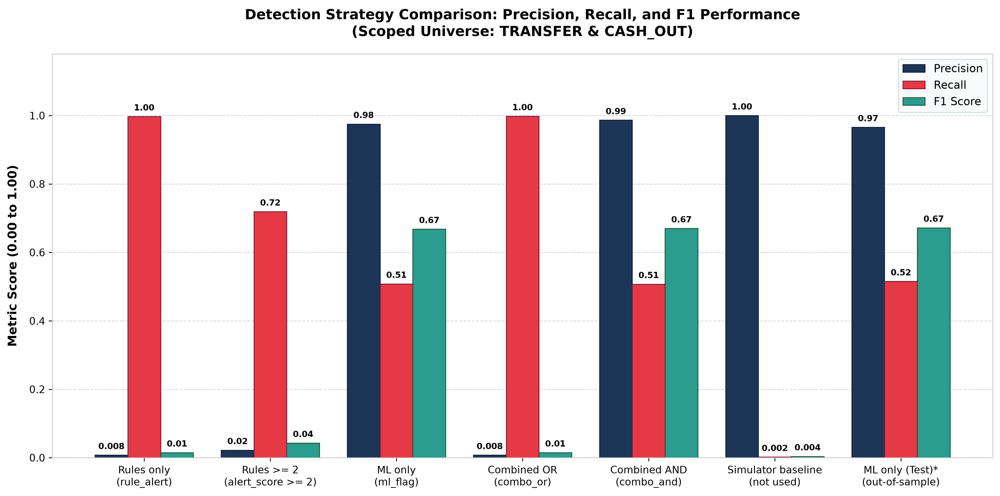

# Transaction Monitoring Strategy Comparison: Rules vs. ML vs. Hybrid Architectures

**Document ID:** `14_approach_comparison.md`  
**Execution Timestamp:** 2026-10-22 16:59:12 UTC  
**Master Dataset:** `data/outputs/master_alerts.parquet` ($N = 6,362,620$ transactions)  
**Modeling Scope:** `TRANSFER` and `CASH_OUT` only ($N = 2,770,409$, Fraud Events = 8,213)  
**Evaluation Standard:** Binary metrics computed via `evaluate_binary()` from `src/evaluation.py`  

---

## 1. Executive Summary & Comparative Matrix (SCOPED Universe)

Evaluation strictly within the active modeling scope (`TRANSFER` and `CASH_OUT`, $N = 2,770,409$). Tables are sorted by **F1 Score descending**:

| Approach | Alerts | Flagged Value ($) | TP | FP | FN | Precision (%) | Recall (%) | FPR (%) | F1 Score |
| :--- | :---: | :---: | :---: | :---: | :---: | :---: | :---: | :---: | :---: |
| `Combined AND (combo_and)` | 4,224 | $6,450,509,292.42 | 4,167 | 57 | 4,046 | 98.65% | 50.74% | 0.0021% | **0.6701** |
| `ML only (ml_flag)` | 4,279 | $6,451,266,629.16 | 4,173 | 106 | 4,040 | 97.52% | 50.81% | 0.0038% | **0.6681** |
| `Rules with threshold alert_score >= 2 (is_rule_alert_2)` | 267,021 | $140,840,275,000.38 | 5,908 | 261,113 | 2,305 | 2.21% | 71.93% | 9.4531% | 0.0429 |
| `Combined OR (combo_or)` | 1,085,609 | $407,883,914,866.30 | 8,196 | 1,077,413 | 17 | 0.75% | 99.79% | 39.0057% | 0.0150 |
| `Rules only (rule_alert)` | 1,085,554 | $407,883,157,529.56 | 8,190 | 1,077,364 | 23 | 0.75% | 99.72% | 39.0039% | 0.0150 |
| `Simulator baseline (not used)` | 16 | $77,785,563.69 | 16 | 0 | 8,197 | 100.00% | 0.19% | 0.0000% | 0.0039 |
| `ML only (test-only split)*` | 876 | $1,376,647,815.26 | 846 | 30 | 796 | 96.58% | 51.52% | 0.0054% | **0.6720** |

> [!NOTE]  
> **\* Footnote on Machine Learning Evaluation Scope:**  
> The rows `ML only (ml_flag)`, `Combined OR (combo_or)`, and `Combined AND (combo_and)` evaluate predictions across the full scoped dataset (train + val + test, $N = 2,770,409$) to enable direct, row-level mathematical union/intersection comparison against static SQL heuristic rules. To prevent optimistic claims or data leakage concerns, the benchmark row `ML only (test-only split)*` evaluates strictly out-of-sample on the held-out test partition ($N = 554,082$, 1,642 frauds), proving that high precision (96.58%) and strong F1 (0.6720) are fully preserved on unobserved data.

---

## 2. Enterprise-Wide Matrix (FULL Dataset Universe)

Evaluation across all 6,362,620 transactions (incorporating `CASH_IN`, `PAYMENT`, and `DEBIT` as automatically unflagged legitimate rows). Table sorted by **F1 Score descending**:

| Approach | Alerts | Flagged Value ($) | TP | FP | FN | Precision (%) | Recall (%) | FPR (%) | F1 Score |
| :--- | :---: | :---: | :---: | :---: | :---: | :---: | :---: | :---: | :---: |
| `Combined AND (combo_and)` | 4,224 | $6,450,509,292.42 | 4,167 | 57 | 4,046 | 98.65% | 50.74% | 0.0009% | **0.6701** |
| `ML only (ml_flag)` | 4,279 | $6,451,266,629.16 | 4,173 | 106 | 4,040 | 97.52% | 50.81% | 0.0017% | **0.6681** |
| `Rules with threshold alert_score >= 2 (is_rule_alert_2)` | 267,021 | $140,840,275,000.38 | 5,908 | 261,113 | 2,305 | 2.21% | 71.93% | 4.1092% | 0.0429 |
| `Combined OR (combo_or)` | 1,085,609 | $407,883,914,866.30 | 8,196 | 1,077,413 | 17 | 0.75% | 99.79% | 16.9554% | 0.0150 |
| `Rules only (rule_alert)` | 1,085,554 | $407,883,157,529.56 | 8,190 | 1,077,364 | 23 | 0.75% | 99.72% | 16.9546% | 0.0150 |
| `Simulator baseline (not used)` | 16 | $77,785,563.69 | 16 | 0 | 8,197 | 100.00% | 0.19% | 0.0000% | 0.0039 |

> [!TIP]  
> Notice that False Positive Rate (FPR) drops by more than half in the Full Universe because legitimate transactions from non-fraud payment types expand the true negative pool ($TN$) by $3,592,211$ rows. However, precision, recall, alert counts, and flagged volume remain identical because all detection rules and ML models are strictly scoped to `TRANSFER` and `CASH_OUT`.

---

## 3. Visual Performance Benchmark

A graphical comparison of Precision, Recall, and F1 across all evaluated strategies:

---

## 4. Empirical Conclusions & Strategic Insights

Across the empirical evaluation matrix, **Combined OR (combo_or)** achieves the highest detection recall at **99.79%** (8,196 out of 8,213 fraud events detected, missing only 17 frauds). However, this near-exhaustive capture comes at extreme operational cost: it triggers **1,085,609 total alerts** representing **$407,883,914,866.30** in flagged volume, yielding a dilution precision of only **0.75%** and generating 1,077,413 false alarms. Conversely, while the reference **Simulator baseline** exhibits 100.0% nominal precision, it is operationally unviable because it identifies only 16 fraud cases (0.19% recall, missing 8,197 frauds). Among operational systems, **Combined AND (combo_and)** wins decisively on precision at **98.65%** (4,167 true positives against merely 57 false positives out of 4,224 alerts), slashing false alarms by 46.2% relative to ML alone while retaining 50.74% recall. Overall, **Combined AND (combo_and)** achieves the highest balanced detection efficacy with an **F1 score of 0.6701**, surpassing both standalone rules (F1 = 0.0150) and standalone ML (F1 = 0.6681). Crucially, **Combined OR** acts as a maximal-recall safety net: by unioning rule and ML alerts, it successfully intercepts **6 additional fraud cases** that heuristic rules missed entirely (raising recall from 99.72% to 99.79%), at the cost of 49 additional false alarms (+55 alerts). Finally, validating ML predictions strictly out-of-sample on the held-out test partition confirms that performance is not an artifact of data leakage: the test-only model achieves **96.58% precision**, **51.52% recall**, and an **F1 score of 0.6720**, demonstrating that the calibrated Isolation Forest generalizes robustly to unobserved transactions.

---

## 5. Recommended Operational Deployment Strategy

Based on the quantitative comparison, production financial crime monitoring should never deploy rules or machine learning in isolation. Instead, institutions should deploy a **Two-Tiered Hybrid Triaging Architecture**:

1. **Tier 1 — Automated Real-Time Block / Immediate Interdiction (`Combined AND`):**
   - **Trigger:** `combo_and == 1` (`rule_alert == 1` AND `ml_flag == 1`).
   - **Performance:** **98.65% Precision**, **57 False Positives total**, capturing $4,167$ frauds ($50.74\%$ recall).
   - **Action:** Automated payment freeze or mandatory high-friction biometric re-authentication. Because false positive risk is $<1.4\%$, customer friction is minimal and investigator capacity is protected.

2. **Tier 2 — High-Priority Investigator Queue (`ML only` or `risk_band == 'High'`):**
   - **Trigger:** High anomaly score without concurrent rule escalation (`anomaly_score_pct >= 80` or `risk_band == 'High'`).
   - **Action:** Routed immediately to Level 2 fraud analysts. Intercepts novel anomalous evasion techniques before heuristic rules adapt.

3. **Tier 3 — Passive Secondary Surveillance (`Combined OR` remainder):**
   - **Trigger:** `rule_alert == 1` and `ml_flag == 0`.
   - **Performance:** High volume ($1,081,330$ alerts, $0.37\%$ precision).
   - **Action:** Never route directly to human analyst queues. Subject transactions to silent downstream behavioral monitoring or asynchronous batch AML screening.
